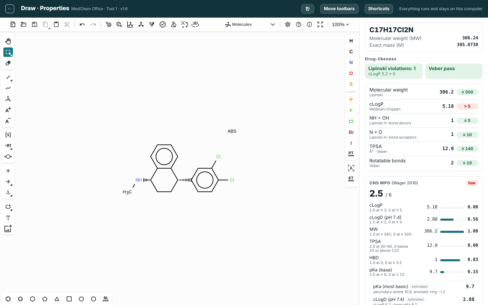
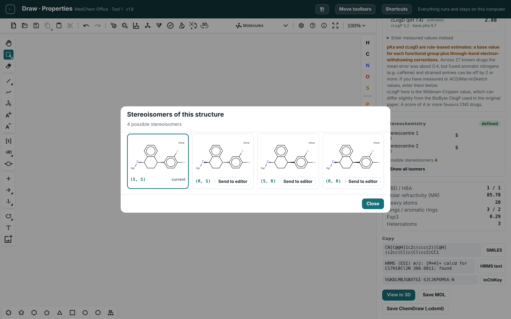
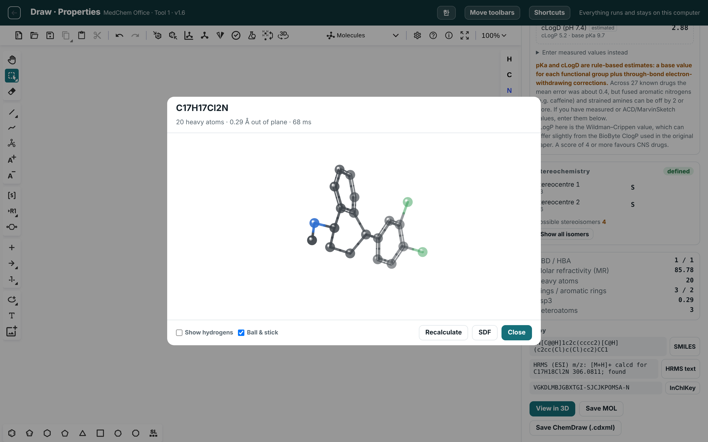

# MedChem Office · 의약화학 오피스

Offline tools for medicinal chemistry. Everything runs in your browser — no server,
no upload, no internet. Your structures never leave your computer.

의약화학자를 위한 오프라인 도구 모음입니다. 모든 계산이 브라우저 안에서 돌아가고,
구조와 데이터는 이 PC 밖으로 나가지 않습니다.

**[Open it →](https://jangkusic.github.io/medchem-office/)**  ·  [Download for offline use](../../releases)



---

## Why

Structure searching on a public server means uploading the structure. For an
undisclosed lead, the search log alone can be a problem. These tools keep the
molecule on your machine: the chemistry engine is plain JavaScript and the
structure editor is bundled, so the page works with the network cable unplugged.

공개 서버에서 구조를 검색한다는 건 그 구조를 외부에 올린다는 뜻입니다. 공개 전
리드 구조라면 검색 기록 자체가 부담이 될 수 있습니다. 이 도구는 분자를 PC 안에
둡니다. 화학 엔진은 순수 자바스크립트이고 구조 편집기도 함께 들어 있어서,
인터넷을 끊어도 그대로 동작합니다.

---

## Tool 1 — Draw · Properties  (구조 그리기 · 물성)

| | |
|---|---|
| **Properties** | MW, exact mass, cLogP, TPSA, HBD/HBA, rotatable bonds, MR, Fsp3 |
| **Rules** | Lipinski (which rules are violated), Veber, CNS MPO |
| **pKa / cLogD** | Estimated, not asked for. Rule-based, with the reasoning shown |
| **Stereochemistry** | Finds stereocentres and E/Z bonds, labels R/S and E/Z, and **draws every stereoisomer** |
| **3D** | Generates real 3D coordinates for the selected fragment. Rotate, zoom, export SDF |
| **Alerts** | Metabolic soft spots, hERG, CYP, drug–drug interaction — structural patterns, not predictions |
| **Compounds** | Save with per-target activity columns, export CSV |
| **Formats** | Read SMILES / MOL / CDXML · Write ChemDraw (.cdxml), MOL, SDF, CSV |

Korean and English, switchable from the top right. Shortcuts match ChemDraw.

**Every stereoisomer, drawn and labelled.** The one on the canvas is outlined; send any other to the editor in one click.



**Real 3D coordinates** for the fragment you select — rings pucker, aromatics stay flat, wedges are respected.



### Shortcuts

Hover an **atom** and press a letter — that atom changes, and your tool stays put.

```
C  N  O  S  P  F  I        L = Cl        B = Br
```

Hover a **bond** and press a number — `1` single, `2` double, `3` triple.
Letters do nothing over a bond, same as ChemDraw.

On **empty canvas** the key picks a tool: `X` single bond, `W` wedge, `H` hash,
`Y` wavy, `T` text, `J` benzene, `E` reaction arrow.

**Space** selects the structure you were just drawing, ready to drag or delete.

All of it undoes with Ctrl+Z. Remap anything under *Shortcuts*, top right.

---

## Coming

2 NMR · 3 Docking & MD · 4 SAR · 5 Properties (SPR) · 6 Toxicity (STR)

All six share one compound list, so saving in one shows up in the others.
여섯 도구가 같은 화합물 목록을 함께 씁니다.

---

## Running it

**In a browser** — open the link above. Nothing to install. The page is static;
your data lives in your own browser's storage.

**Offline** — download the release, unzip, open `index.html`. Keep the folder
together: a tool folder on its own cannot find `common/`.

내려받아 압축을 풀고 `index.html` 을 여세요. 폴더는 통째로 두셔야 합니다.

Chrome or Edge. Safari restricts local file access and may not load the shared
scripts from `file://`.

> Your compound list is stored per-origin. The hosted page and a local copy keep
> **separate** lists, and clearing browser data erases them. Export CSV to keep a copy.

---

## Accuracy

These are calculations, not measurements, and some are estimates.

- **cLogP, TPSA, HBD/HBA, rotatable bonds** — validated against RDKit's own
  regression data: 0 mismatches in 98 compounds for MolLogP, TPSA and HBD;
  199/200 on the NCI TPSA set.
- **pKa, cLogD** — rule-based: functional-group base values plus through-bond
  electron-withdrawing corrections. Mean absolute error 0.4 across 27 known
  drugs, but fused aromatic nitrogens (caffeine) and strained amines can be off
  by 2 or more. The reasoning is shown so you can judge it. Override with
  measured values when you have them.
- **R/S and E/Z** — computed by Indigo, the engine inside Ketcher.
- **3D coordinates** — bond lengths, angles, planarity and sterics only.
  Aromatic rings come out flat (0.00 Å), cyclohexane puckers to a chair (0.25 Å),
  and stereocentres are preserved. Good enough to look at; **not** good enough to
  dock. Rebuild coordinates in a dedicated program before docking.
- **Alerts** — known structural patterns with a reason and a suggested direction.
  They are not predictions of metabolism or toxicity.

계산값은 참고용입니다. 특히 pKa·cLogD 는 경험 규칙 추정값이고, 3D 좌표는 보기용이지
도킹에 바로 넣을 품질이 아닙니다.

---

## Built on

[Ketcher](https://github.com/epam/ketcher) by EPAM (Apache-2.0) for structure
editing, CIP assignment and rendering. Descriptor implementations follow
[RDKit](https://github.com/rdkit/rdkit) (BSD-3-Clause). See [NOTICE](NOTICE).

## License

Apache License 2.0 — see [LICENSE](LICENSE).
